# TopoKit – instrumente AutoLISP pentru topografie și cadastru

Suită modulară AutoLISP + DCL pentru AutoCAD (în stilul TopoLT):

| Comandă | Modul |
|---|---|
| `TOPOKIT` / `MYTOPO` | Meniul grafic (DCL) cu cele 5 module și setările lor |
| `ADDVTX` | Corecție topologică – vertex-uri la intersecțiile poliliniilor |
| `EXPKMZ` | Export parcelă închisă în KMZ/KML (Stereo 70 → WGS84) + deschidere în Google Earth Pro |
| `INSCADRU` | Format A4…A0 (portrait/landscape), cadru și indicator la scară |
| `ANEXE` | Generatorul de anexe pentru **Ordinul ANCPI nr. 600/2023**: PAD, dezlipire/alipire, releveu și documentele Word ([detalii](#4-generator-de-anexe--ordinul-ancpi-nr-6002023-anexe)) |
| `TOPOTEREN` | Modulul de teren: import puncte și desenare pe coduri, model TIN, curbe de nivel, volume, raster georeferențiat, KML/KMZ, tabele și legende ([detalii](#5-teren--puncte-model-3d-curbe-de-nivel-volume-topoteren)) |

## Interfața

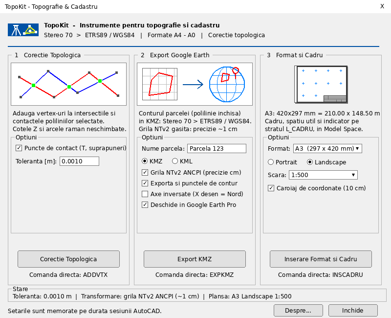

*Machetă aproximativă a dialogului `TOPOKIT`, generată din `TopoKit.dcl` cu valorile și imaginile
completate de codul LISP real (rulat în simulatorul din `tests/`). Fonturile și dimensiunile exacte diferă în AutoCAD.*

- **Antet:** siglă (teodolit și rețea de triangulație) și o linie de separare colorată.
- **Pictograme pentru fiecare modul.** Pictograma corecției topologice marchează cu verde punctele de
  intersecție, calculate chiar cu funcțiile din `ADDVTX`.
- **Previzualizarea planșei:** proporțiile formatului, orientarea, cadrul interior, indicatorul și caroiajul
  se redesenează la orice modificare, atât în meniul principal, cât și în dialogul `INSCADRU`:

  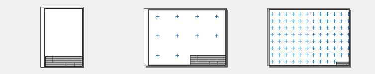
- **Opțiuni grupate pe module**, taste rapide (Alt+C / E / I / A / D) și o bară de stare cu toleranța,
  metoda de transformare (grilă sau Helmert) și planșa curentă.

## Instalare

### Cu instalatorul (recomandat)

1. Descărcați și rulați **[`dist/TopoKitSetup.exe`](dist/TopoKitSetup.exe)**. Nu sunt necesare drepturi
   de administrator; instalarea se face pentru utilizatorul curent.
2. Alegeți opțiunile: scurtătură pe desktop și pornirea în fundal odată cu Windows (ambele bifate implicit).
3. Deschideți **TopoKit** din meniul Start sau de pe desktop. Atât.

Ce face instalarea:

| Ce | Unde |
|---|---|
| Pachetul AutoCAD (`TopoKit.bundle`): toate fișierele `.lsp`/`.dcl`, grila `.gsb`, șabloanele `anexe` | `%APPDATA%\Autodesk\ApplicationPlugins\TopoKit.bundle` |
| Lansatorul `TopoKit.exe`, ghidul `README.html`, dezinstalarea | `%LOCALAPPDATA%\Programs\TopoKit` |
| Meniul Start, desktop, pornirea cu Windows, *Aplicații instalate* | registrul `HKCU` |

- **AutoCAD încarcă TopoKit automat** în fiecare desen (AutoCAD 2013 sau mai nou, inclusiv Civil 3D și
  Map 3D), prin mecanismul *Autoloader* (`PackageContents.xml`). Nu mai sunt necesare `APPLOAD`,
  *Startup Suite* sau setări manuale: `TopoKitLoad.lsp` adaugă folderul în *Support File Search Path*
  și în *Trusted Locations* (`TRUSTEDPATHS`), apoi încarcă `TopoKit.lsp`, `TopoKitAnexe.lsp` și
  `TopoKitTeren.lsp`. Comanda `TOPOKITRELOAD` reîncarcă modulele.
- **Lansatorul rulează în fundal** (iconița de lângă ceas) și ține legătura cu AutoCAD prin COM:

  

  - iconița e **verde** când AutoCAD rulează (tooltip: versiunea și desenul activ) și **gri** când nu rulează;
  - când deschideți TopoKit, se deschide meniul `TOPOKIT` în AutoCAD; dacă AutoCAD nu rulează, este
    pornit, iar meniul apare după ce AutoCAD s-a încărcat (dacă nu există niciun desen, se creează unul);
  - din meniul iconiței (clic dreapta) se pornesc direct `ANEXE`, `TOPOTEREN`, `VERIFICARE`, `PLANEPDF`,
    `EXPKMZ`, `INSCADRU` și `ADDVTX`;
  - tot din meniu: *Pornește AutoCAD*, *Reîncarcă TopoKit*, *Pornește odată cu Windows*, folderul
    programului și ghidul;
  - dublu clic pe iconiță sau **Ctrl+Alt+Shift+T** deschide meniul `TOPOKIT`;
  - dacă TopoKit nu era încărcat în desen (de exemplu, AutoCAD era deschis în timpul instalării),
    lansatorul îl încarcă înainte de comandă;
  - linie de comandă: `TopoKit.exe /cmd ANEXE` (orice comandă TopoKit), `/background` (doar în fundal),
    `/quit` (închide lansatorul). Jurnalul se află în `%LOCALAPPDATA%\TopoKit\TopoKit.log`.
- **Dezinstalare:** *Setări → Aplicații → TopoKit* sau meniul Start → *Dezinstalare TopoKit*. Se șterg
  pachetul AutoCAD, lansatorul și setările din registru.
- **Instalare silențioasă** (pentru mai multe calculatoare): `TopoKitSetup.exe /S`; dezinstalare:
  `"%LOCALAPPDATA%\Programs\TopoKit\Uninstall.exe" /S`.

Windows SmartScreen poate afișa *„Windows a protejat computerul”*, pentru că instalatorul nu este
semnat digital: alegeți *Mai multe informații → Rulați oricum*.

### Manual (fără instalator)

1. Copiați `TopoKit.lsp`, `TopoKit.dcl`, `stereo70_etrs89A.gsb`, `TopoKitAnexe.lsp`, `TopoKitAnexe.dcl`,
   `TopoKitTeren.lsp`, `TopoKitTeren.dcl` și folderul `anexe` în același folder. Adăugați folderul în *Support File Search Path* (și în *Trusted Locations*,
   dacă AutoCAD cere confirmarea încărcării).
2. În AutoCAD: `APPLOAD` → `TopoKit.lsp` (sau adăugați-l în *Startup Suite*). Generatorul de anexe
   (`TopoKitAnexe.lsp`) și modulul de teren (`TopoKitTeren.lsp`) se încarcă automat dacă sunt găsite
   în calea de suport.
3. Rulați `TOPOKIT` sau direct `ANEXE`.

Fișierul `.dcl` este opțional: dacă nu este găsit, `TopoKit.lsp` generează automat o copie
identică într-un fișier temporar. Funcționează în AutoCAD 2013+ (Windows), inclusiv versiunile
cu `LISPSYS = 1`. Mesajele din AutoCAD nu folosesc diacritice, ca să se afișeze corect indiferent de codificarea sistemului.

**Convenții:** unitatea desenului este metrul. Implicit, X din AutoCAD = Est (Y Stereo 70) și
Y din AutoCAD = Nord (X Stereo 70). Pentru desenele cu axele inversate bifați *Axe inversate*.

## 1. Corecție topologică – `ADDVTX`

- Selectați oricâte `LWPOLYLINE` / `POLYLINE` (2D sau 3D).
- Intersecțiile se calculează **în plan (XY)** între toate perechile de polilinii: segment–segment,
  segment–arc și arc–arc (arcele sunt tratate exact, pe baza bulge-ului).
- Opțional (*Include punctele de contact*, activ implicit), sunt tratate și punctele de contact:
  îmbinări în „T”, capete situate pe alt segment și capetele suprapunerilor colineare.
- Vertex-ul nou este proiectat exact pe segmentul fiecărei polilinii, astfel:
  - forma segmentelor nu se schimbă: la arce, bulge-ul se împarte exact în sub-arce;
  - cota Z se interpolează pe segmentul propriu (polilinii 3D); elevația LWPOLYLINE rămâne aceeași;
  - lățimile de segment se interpolează.
- Punctele aflate la o distanță mai mică decât toleranța (implicit 0.001 m) de un vertex existent sau
  de un alt punct nou sunt ignorate, ca să nu se creeze duplicate.
- Mesaj final: `S-au procesat X polilinii si s-au adaugat Y vertex-uri noi.`

Ce nu se procesează: plasele 3D, polifețele, poliliniile netezite (spline/curve-fit) și cele
neparalele cu planul XY, precum și poliliniile de pe straturi blocate (sunt raportate separat).
LWPOLYLINE își păstrează handle-ul. POLYLINE 2D/3D „clasice” se reconstruiesc (proprietățile și
datele extinse sunt copiate), deci primesc un handle nou.

## 2. Export KMZ – `EXPKMZ`

1. Selectați o polilinie închisă (flag *Closed* sau capete care coincid).
2. Vertex-urile sunt transformate din Stereo 70 în ETRS89/WGS84 direct în LISP:
   - **inversa proiecției stereografice oblice** (EPSG metoda 9809, sferă conformă Gauss) pe
     elipsoidul Krasovsky 1940: φ₀ = 46°N, λ₀ = 25°E, k₀ = 0.99975, FE = FN = 500 000 m;
   - **grila de distorsiuni NTv2** `stereo70_etrs89A.gsb` (metoda implicită, **precizie centimetrică**).
     Este sub-grila „ANCPI+TN”, derivată din grila oficială ANCPI/TransDatRO, cu pas de 35″ × 50″ (~1 km).
     Deplasările se interpolează biliniar, exact ca în PROJ `hgridshift`. Fișierul binar este citit
     direct din LISP (prin `ADODB.Stream`), așa că nu e nevoie de alte programe;
   - **Helmert 7 parametri** (rezervă) S-42 → WGS84 (EPSG:15994, *Coordinate Frame*):
     tx = 2.329 m, ty = −147.042 m, tz = −92.080 m, rx = 0.309″, ry = −0.325″, rz = −0.497″, ds = 5.69 ppm.
     Se folosește dacă grila lipsește sau pentru punctele din afara zonei acoperite de grilă, de exemplu
     la graniță. Numărul punctelor transformate astfel este raportat.

   | Metodă | Precizie |
   |---|---|
   | Grila NTv2 – față de cele 11 puncte de control ETRS89 publicate cu grila | 2–13 mm |
   | Grila NTv2 din LISP – față de PROJ `hgridshift` (296 de puncte aleatoare) | < 0.01 mm |
   | Helmert – față de grilă, pe teritoriul României | 0.3 m median, ~1.5 m (p99) |

   **Grila este inclusă în depozit** (`stereo70_etrs89A.gsb`, 5.7 MB). Păstrați-o în același folder cu
   `TopoKit.lsp`; se caută și în căile de suport AutoCAD și în folderul desenului. Dialogul `TOPOKIT` arată
   dacă a fost găsită. Sursa este [tudorbarascu/stereo70-etrs89](https://github.com/tudorbarascu/stereo70-etrs89),
   iar grila a fost generată de Daniel Urdă ([ntv2generator](https://github.com/danieluct/ntv2generator)) din grila
   ANCPI. Sursa nu precizează o licență. Punctele de control folosite la testare sunt în
   `tests/data/verification_points/`.

   Coordonatele rezultate sunt în ETRS89. Față de WGS84 actual (ITRF), ETRS89 diferă cu ~0.8 m în 2026
   din cauza derivei plăcii eurasiatice. Diferența este sub precizia imaginilor Google Earth, care au de
   regulă erori de 1–5 m, dar contează dacă folosiți coordonatele pentru măsurători GNSS. Pentru lucrări
   oficiale, TransDatRO rămâne referința.
3. Fișierul `NumeDesen_NumeParcela_AAAAMMZZ_hhmmss.kmz` se salvează în folderul desenului
   (sau în `C:\Temp` dacă desenul nu a fost salvat). Conține poligonul (contur roșu, umplere
   semitransparentă), suprafața, perimetrul și, opțional, punctele de contur numerotate.
   Arcele sunt densificate (16 sub-segmente).
4. KMZ-ul (arhiva ZIP cu `doc.kml`) este creat cu PowerShell `Compress-Archive`. Dacă PowerShell nu
   este disponibil, se salvează un fișier `.kml`.
5. Fișierul se deschide automat în Google Earth Pro, dacă aplicația este găsită (în registru sau în
   `Program Files`). Altfel se deschide cu aplicația asociată extensiei.

La coordonate în afara domeniului Stereo 70 (de exemplu axe inversate sau un sistem local) programul
cere confirmare înainte de export.

## 3. Format, cadru și indicator – `INSCADRU`

- Sub-dialogul permite alegerea formatului (A4, A3, A2, A1, A0), a orientării (Portrait/Landscape), a scării
  (1:100, 1:200, 1:500, 1:1000, 1:2000, 1:5000), a caroiajului și a textelor din indicator.
- Indicați colțul stânga-jos al formatului în Model Space.
- Factorul de scară este **f = scara / 1000** (mm pe hârtie → m în teren). Exemplu: A3 landscape
  420 × 297 mm la 1:500 → 210 × 148.5 m.
- Se desenează pe stratul **`L_CADRU`**:
  - cadrul exterior (marginea foii, grosime 0.25);
  - cadrul interior / spațiul util (grosime 0.50), cu margini de 20 mm la stânga și 5 mm (A4, A3)
    sau 10 mm (A2–A0) în rest;
  - indicatorul: blocul cu atribute `TK_CARTUS`, de 180 × 50 mm, în colțul dreapta-jos. Câmpurile
    sunt beneficiar, lucrare, titlu, executant, scară, format, întocmit, dată și nr. planșă.
    Scara, formatul și data se completează automat, iar câmpurile se pot edita cu `EATTEDIT`;
  - opțional, caroiajul de coordonate: cruci la 10 cm pe hârtie, la valori rotunde, cu gradații și
    etichete X/Y pe cadrul interior.

## 4. Generator de anexe – Ordinul ANCPI nr. 600/2023 (`ANEXE`)

Modulul `TopoKitAnexe.lsp` generează piesele desenate (în layout-uri AutoCAD) și piesele scrise
(documente Word completate) din Regulamentul de recepție și înscriere aprobat prin Ordinul ANCPI
nr. 600/2023.

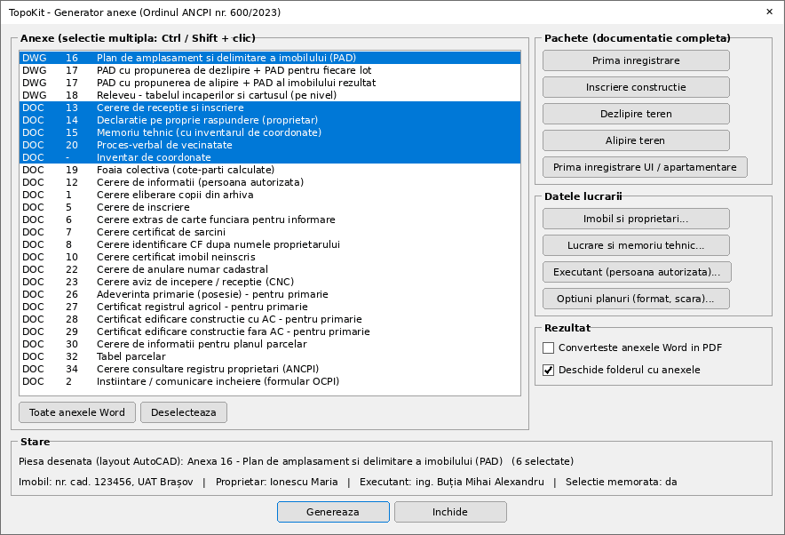

*Machetă a dialogului `ANEXE` după alegerea pachetului „Prima înregistrare”, generată din
`TopoKitAnexe.dcl` cu listele și textele completate de codul LISP.*

| Comandă | Ce face |
|---|---|
| `ANEXE` (`TKANEXE`) | Meniul: alegeți anexele sau un pachet, completați datele lucrării și apăsați **Genereaza** |
| `PAD` | Anexa 16 – plan de amplasament și delimitare a imobilului |
| `PADDEZ` | Anexa 17 – PAD cu propunerea de dezlipire, plus câte un PAD (anexa 16) pentru fiecare lot |
| `PADALIP` | Anexa 17 pentru alipire, plus PAD-ul imobilului rezultat |
| `RELEVEU` | Anexa 18 – releveul unui nivel: tabelul încăperilor, cartușul, numerele încăperilor |
| `VECINI` | Vecinii, identificatorii, materializarea și observațiile pentru fiecare latură |
| `CONSTRUCTIE` | Datele construcțiilor: cod, destinație, denumire, regim de înălțime, an, Sd, număr de UI |
| `DATEIMOBIL` / `EXECUTANT` | Datele imobilului și ale proprietarilor / datele persoanei autorizate |
| `ANEXEWORD` | Anexele Word 13, 14, 15, 20 și inventarul de coordonate pentru imobilul selectat |
| `VERIFICARE` | Verificarea datelor lucrării și a geometriei imobilului memorat (și butonul din meniu) |
| `PLANEPDF` | Plotează în PDF toate planurile generate din desen (layout-urile `PAD_*`, `RELEVEU_*`) |

**Pachetele** din meniu selectează anexele unei documentații complete. Orice anexă se poate alege
și separat din listă (selecție multiplă).

| Pachet | Piese desenate | Documente Word |
|---|---|---|
| Prima înregistrare | PAD (16) | 13, 14, 15, 20, inventar de coordonate |
| Înscriere construcție | PAD (16) | 13, 14, 15, inventar |
| Dezlipire teren | PAD dezlipire (17) + PAD pe loturi | 13, 14, 15, inventar (și câte unul pe lot) |
| Alipire teren | PAD alipire (17) + PAD rezultat | 13, 14, 15, inventar |
| Prima înregistrare UI / apartamentare | Releveu (18) | 19 (foaia colectivă), 13, 15 |

### Planul de amplasament și delimitare (anexa 16)

1. Datele executantului (nume, autorizație, categorie) se completează o dată și rămân pe calculator.
   Datele imobilului, ale proprietarilor și ale lucrării se salvează în desen.
2. După **Genereaza** selectați conturul imobilului (polilinie închisă), construcțiile (Enter = fără)
   și parcelele de folosință (Enter = o singură categorie, cea din datele imobilului). Pentru
   construcțiile noi se cer datele lor; codurile C1, C2… se dau în ordinea selecției.
3. În dialogul **Laturi și vecinătăți**, butonul *Detecteaza din desen* propune pentru fiecare latură
   textul cel mai apropiat din exteriorul ei (de exemplu „nr. cad. 1234”, „str. Lalelelor”).
   Vecinul, materializarea și observațiile se pot da mai multor laturi deodată: se aplică doar
   câmpurile modificate.

   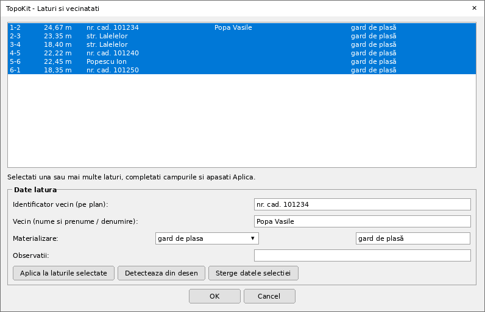
4. **Verificarea** rulează înainte de desenare și are trei niveluri: erori, atenționări și informații.
   - Erori: contur autointersectat, loturi care nu acoperă exact imobilul sau care se suprapun.
   - Atenționări: date lipsă (executant, proprietar, UAT, adresă, număr cadastral), coordonate în afara
     Stereo 70, laturi în arc, laturi foarte scurte (puncte duble), construcții care depășesc limita,
     parcele de folosință care nu acoperă imobilul.
   - Informații: laturile fără vecin și diferența de suprafață față de act.

   La erori sau atenționări apare raportul, iar generarea continuă doar dacă alegeți *Continua*:

   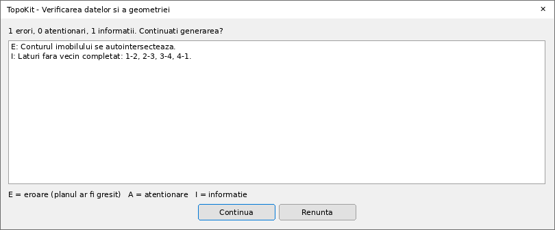
5. Se creează layout-ul `PAD_<nr. cadastral>`. Desenul din model space nu se modifică. Cu opțiunea
   *Ploteaza planurile in PDF* (sau comanda `PLANEPDF`), fiecare plan se plotează automat în
   `Anexe_<nr. cadastral>\<layout>.pdf`.

Ce conține planul:

- **Pagina** are setările *DWG To PDF* (ISO full bleed, 1:1, mm), deci se plotează direct în PDF.
  Formatul și scara se aleg automat: scara cea mai mare din 1:200, 1:250, 1:500, 1:1000, 1:2000,
  1:2500, 1:5000 la care imobilul încape pe A4 sau A3, apoi pe A2–A0. Ambele se pot fixa din
  *Optiuni planuri*. Regulamentul cere PAD-ul în PDF, la o scară convenabilă între 1:200 și 1:5000.
- Un **viewport blocat**, la scara exactă, arată desenul din model (imobilul și vecinătatea). Peste el,
  în paper space, pe straturile `PAD_*`, se desenează:
  - conturul și punctele numerotate, după opțiune:
    - în sens orar, din punctul cel mai apropiat de colțul N-V, de la un număr ales;
    - în ordinea poliliniei;
    - **cu numerele punctelor din desen**: textul sau blocul de punct (cu atribut numeric) aflat lângă
      fiecare vârf, ca la numerotarea din ridicare (127, 128…). Vârfurile fără număr primesc numere în
      continuare;
  - lungimile laturilor (2 zecimale, cu virgulă sau punct);
  - vecinii. O etichetă nu se mai scrie dacă același text există deja în model lângă latură;
  - construcțiile cu codurile lor și parcelele de folosință;
  - săgeata nordului, coordonatele N= / E= ale colțurilor și, opțional, inventarul de coordonate.
- **Tabelele:**
  - antetul (număr cadastral, suprafață măsurată, adresă, CF, UAT);
  - tabelul A (teren). Dacă *Mentiuni teren* este gol, mențiunile se compun din materializarea
    laturilor (de ex. „Imobil împrejmuit cu gard de plasă.”);
  - tabelul B (construcții). Coloana *Mențiuni* conține destinația, regimul de înălțime, anul, Sc și Sd;
  - suprafața măsurată și cea din act;
  - semnăturile *Executant* (cu autorizația) și *Inspector*.

  Suprafețele se calculează analitic din coordonatele vârfurilor (ca în inventar) și sunt în mp
  întregi. Suprafețele parcelelor și ale loturilor se rotunjesc astfel încât suma lor să fie exact
  suprafața imobilului.

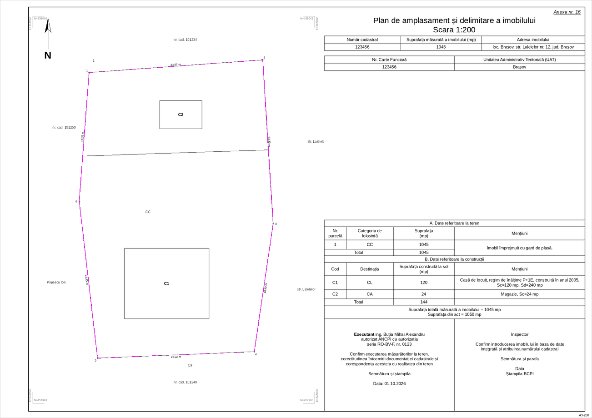

### Dezlipire și alipire (anexa 17)

- `PADDEZ`: selectați conturul imobilului, apoi loturile pe rând (Enter la final), construcțiile și
  parcelele. Punctele noi de pe conturul imobilului (capetele limitelor dintre loturi) se intercalează
  în numerotare. Numerotarea este comună tuturor planurilor, deci un punct are același număr pe
  planul de dezlipire și pe PAD-ul fiecărui lot.
- Tabelul *Situația actuală / Situația viitoare* conține numărul cadastral, suprafața, categoria de
  folosință și descrierea („Lot 1 – Curți construcții”).
- Pentru fiecare lot se creează PAD-ul „… – lot N” (anexa 16), fără număr cadastral și CF. Laturile
  dintre loturi au ca vecin „Lot N”, iar laturile de pe contur moștenesc vecinul imobilului.
- `PADALIP`: imobilele inițiale (cu numerele lor cadastrale), apoi conturul imobilului rezultat.

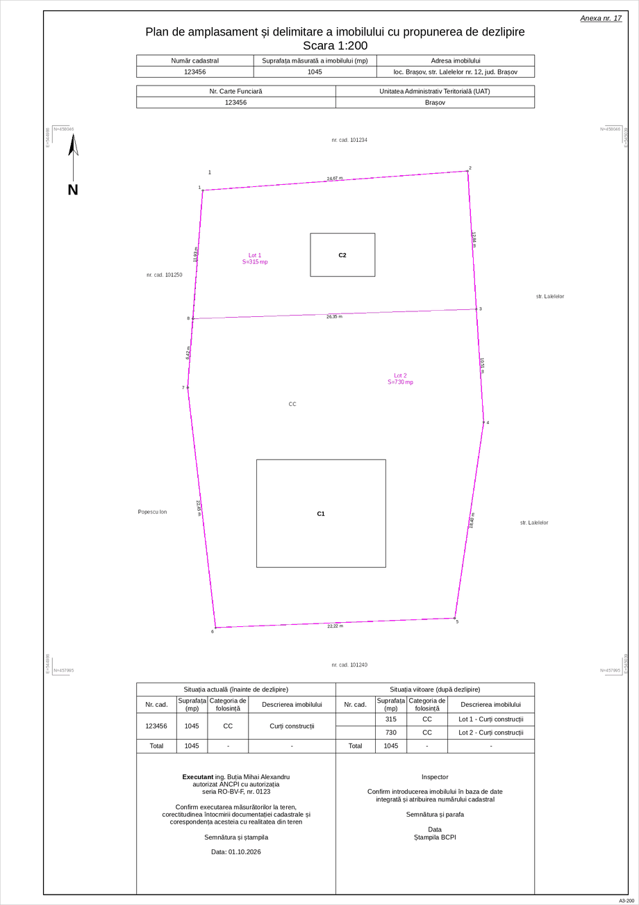
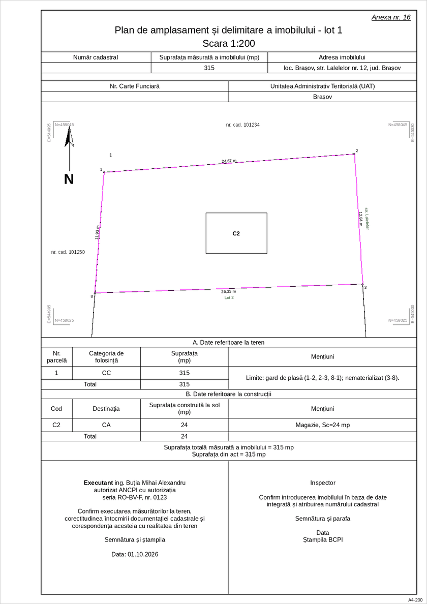

### Releveul (anexa 18) și foaia colectivă (anexa 19)

- `RELEVEU` cere trei lucruri:
  - încăperile: polilinii închise, cu denumirea scrisă în interior;
  - contururile unităților individuale: denumirea (de ex. „Apartament 1”) scrisă în contur, în afara
    încăperilor;
  - numele nivelului.

  Balcoanele, logiile, terasele, casa scării, podul și prispa nu intră în suprafața utilă. Layout-ul
  `RELEVEU_<nivel>` (A3–A1, 1:50–1:200) are:
  - tabelul încăperilor, cu suprafața utilă și cea totală pentru fiecare UI;
  - antetul (număr cadastral, adresă, CF colectivă, UAT);
  - semnăturile;
  - numerele încăperilor, încercuite.
- UI-urile se memorează în desen, pentru foaia colectivă (anexa 19). Pentru fiecare UI se
  completează:
  - suprafața utilă;
  - codul (`<nr. cad.>-C1-U<n>`);
  - Cpc = Suap/Stuap, de forma `671/20401`;
  - Cpt = Suap/Stuap × St, de forma `2819/258200`. Cotele se rotunjesc astfel încât suma să fie
    egală cu terenul aferent;
  - observațiile, din denumirile încăperilor.

  Dacă terenul este comun mai multor clădiri, completați *Teren aferent clădirii*.

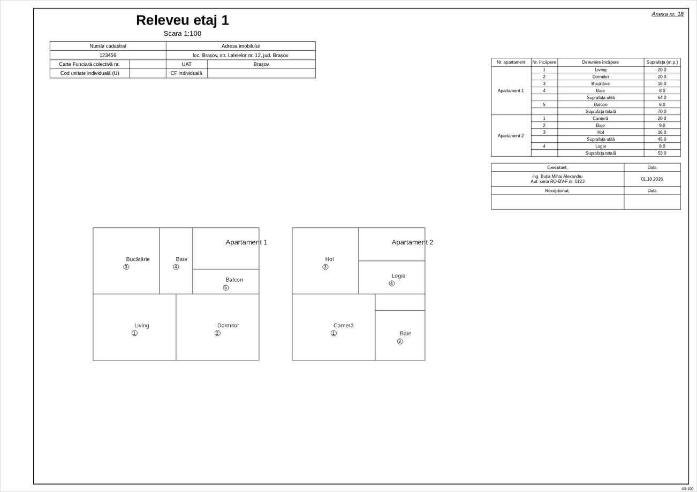

### Documentele Word

- Șabloanele din `anexe/` sunt generate din textul oficial al ordinului. Sunt 31 de anexe (1–35,
  fără piesele desenate 16, 17, 18 și 31) plus inventarul de coordonate. Spațiile punctate au devenit
  câmpuri: cele cu date se completează automat, iar celelalte își păstrează punctele, pentru
  completare de mână.
- Completarea folosește scriptul `anexe/TopoKitDocx.ps1`, cu Windows PowerShell 5.1 (inclus în
  Windows 10/11); Word nu este necesar. Pentru conversia opțională în PDF este nevoie de
  Microsoft Word sau de LibreOffice.
- Rezultatul se salvează în folderul `Anexe_<nr. cadastral>` de lângă desen (sau în `C:\Temp`). Dacă un
  document generat anterior este încă deschis în Word, noul document se salvează ca `…_2.docx`.
- Ce se completează automat:
  - **cererea de recepție și înscriere (13)**, cu bifele după tipul lucrării și modul de comunicare;
  - **declarația (14)**: bifele se pun după date. „Poziționare incertă” și litigiul (ID, dosar,
    instanță, obiect) se completează în dialogul lucrării; informarea coproprietarilor se bifează
    doar dacă există un al doilea proprietar;
  - **memoriul tehnic (15)**: adresa, scopul, documentarea, operațiunile (texte implicite, care se
    pot rescrie în dialog), construcțiile, inventarul de coordonate cu laturile, suprafața și perimetrul;
  - **PV de vecinătate (20)**: proprietarii (cu CNP-ul pe căsuțe), vecinii, tabelul laturilor cu
    lungimea, materializarea și vecinul, apoi câte o linie de semnătură pentru fiecare vecin;
  - **foaia colectivă (19)** și **inventarul de coordonate**;
  - **celelalte formulare** (1, 5–8, 10, 12, 22, 23, 26–30, 34), cu datele solicitantului, ale
    imobilului și ale persoanei autorizate, acolo unde formularul le cere. Rândurile tabelului
    parcelar (32) rămân de completat.
- Formularele emise de OCPI/CNC (anexele 2, 3, 4, 9, 11, 21, 24, 25, 33, 35) sunt incluse ca
  șabloane, fără completare automată.

### Unde se salvează datele

| Unde | Ce |
|---|---|
| Desen (dicționarul `TOPOKIT_ANEXE`) | datele imobilului, proprietarilor și lucrării; selecțiile, pentru regenerare fără reselectare (*Folositi imobilul selectat anterior?*); UI-urile releveelor |
| Entitățile din desen (ldata) | datele construcțiilor, ale laturilor (vecini, materializare) și categoriile parcelelor |
| Calculator (registrul AutoCAD) | datele executantului |

### Limitări

- Textul folosit este forma consolidată a ordinului valabilă la 24.11.2025 (fișierul furnizat).
  Modificările ulterioare nu sunt incluse.
- În textul ordinului, anexele 16 și 17 apar doar ca facsimil, fără conținut. Machetele PAD reproduc
  exemplele primite (PAD, propunere de dezlipire, PAD pe loturi, releveu, foaie colectivă).
- Conturul de pe plan unește vârfurile poliliniei: laturile în arc se desenează, se cotează și intră în
  suprafață ca segmente (verificarea le semnalează; adăugați puncte pe arce).
- Generatorul a fost testat într-un simulator AutoCAD (vezi *Dezvoltare*), nu și în AutoCAD.
  Verificați primul plan generat: setările de pagină *DWG To PDF* și viewport-ul.

## 5. Teren – puncte, model 3D, curbe de nivel, volume (`TOPOTEREN`)

Modulul `TopoKitTeren.lsp` are meniul `TOPOTEREN` (și secțiunea 5 din `TOPOKIT`). Opțiunile din meniu
(formatul fișierului, scara, echidistanța, cota de referință...) sunt folosite și de comenzile directe.

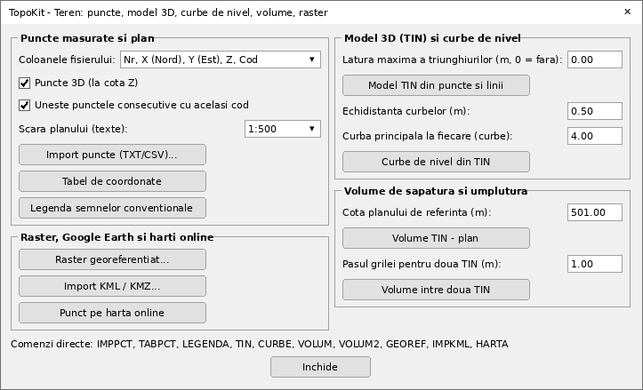

| Comandă | Ce face |
|---|---|
| `IMPPCT` | Import puncte măsurate din TXT/CSV și desenare rapidă pe coduri |
| `TABPCT` | Tabel cu coordonatele punctelor selectate (Nr, X, Y, Z), pe coloane de 40 de rânduri |
| `LEGENDA` | Legenda semnelor convenționale din desen: blocurile (cu descrierea din definiție) și straturile de linii |
| `TIN` | Modelul 3D al terenului: triangulație Delaunay din puncte 3D și linii de frângere (3DFACE) |
| `CURBE` | Curbe de nivel din TIN: principale și secundare, cu cote |
| `VOLUM` | Volume de săpătură și umplutură între TIN și un plan de cotă dată |
| `VOLUM2` | Volume între două TIN (teren existent – proiect) |
| `GEOREF` | Inserarea unei imagini raster georeferențiate (fișier world `.jgw`, `.tfw`, `.pgw`, `.wld`) |
| `IMPKML` | Import KML/KMZ din Google Earth (puncte, linii, poligoane), WGS84 → Stereo 70 |
| `HARTA` | Deschide punctul indicat în Google Maps |

- **Import puncte (`IMPPCT`).** Fișierul are pe fiecare rând `Nr, X (Nord), Y (Est), Z, Cod`. Ordinea
  coloanelor se alege în meniu, inclusiv `Nr, Y, X, Z, Cod` sau `X, Y, Z` fără număr.
  - Separatorul se detectează singur: `;`, tab, virgulă sau spații. Cu `;`, tab sau spații se acceptă
    și virgula zecimală (`512,30`). Rândurile de antet se ignoră.
  - Fiecare punct devine un `POINT` la cota Z (sau la Z = 0 pentru plan 2D), cu numărul și cota scrise
    lângă el (straturile `PUNCTE`, `PCT_NR`, `PCT_COTA`).
  - **Desenarea pe coduri:** punctele consecutive cu același cod (`GARD`, `DRUM`...) se unesc într-o
    polilinie 3D sau 2D pe stratul `COD_<cod>`.
- **Model TIN (`TIN`).**
  - Selectați punctele (`POINT`, blocuri de punct) și, opțional, liniile de frângere (`LINE`, polilinii
    2D/3D). Liniile de frângere se densifică, astfel încât triunghiurile să le urmărească.
  - Se pot elimina triunghiurile cu latura mai mare decât o valoare dată și cele din afara unui contur
    selectat.
  - Rezultatul: entități `3DFACE` pe stratul `TIN`, folosibile și de alte programe.
- **Curbe de nivel (`CURBE`).** Se generează pe orice TIN din `3DFACE`, la echidistanța aleasă, ca polilinii
  la cota lor, pe straturile `CURBE_PRINC` și `CURBE_SEC`. Curbele principale (la fiecare N curbe) au
  cota scrisă pe ele.
- **Volume.**
  - `VOLUM` calculează exact, triunghi cu triunghi, volumul față de planul de referință: săpătură
    (terenul deasupra cotei) și umplutură, cu ariile lor.
  - `VOLUM2` compară două TIN pe o grilă de pasul ales: umplutură acolo unde proiectul este deasupra
    terenului existent.
  - Rezultatele apar în linia de comandă și, opțional, într-un tabel în desen.
- **Raster și Google Earth.**
  - `GEOREF` inserează imaginea la poziția, mărimea pixelului și rotația din fișierul world.
  - `IMPKML` citește KML sau KMZ (KMZ-ul se dezarhivează cu PowerShell). Transformarea WGS84 → Stereo 70
    este inversarea numerică a transformării din `EXPKMZ`, cu aceeași precizie (grila NTv2). Dus-întors
    Stereo 70 → KML → Stereo 70 dă diferențe sub 0,01 mm.
  - `HARTA` deschide în browser punctul indicat (sau centrul ecranului) în Google Maps.
- **Formatare automată.** Layout-urile cu cadru, indicator și caroiaj de coordonate sunt în modulele 3
  (`INSCADRU`) și 4 (planurile anexelor).

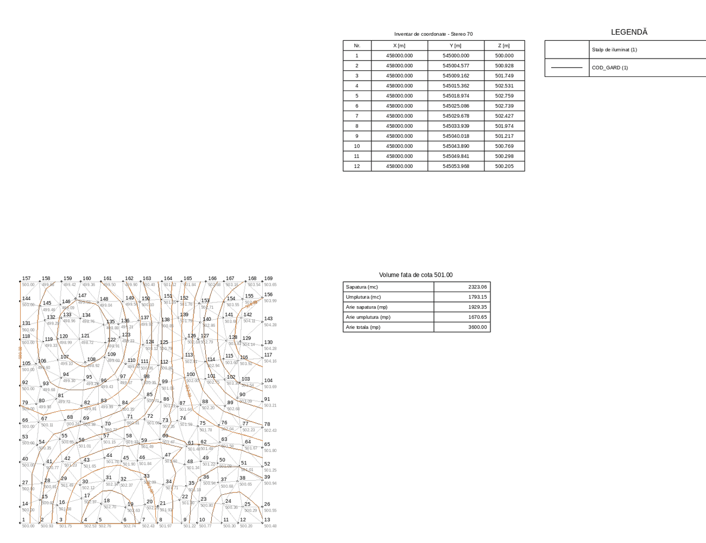

*Desen de test generat de comenzile modulului în simulator: punctele importate cu numere și cote,
TIN-ul (gri), curbele de nivel, tabelul de coordonate, legenda și tabelul volumelor.*

Limitări:
- Triangulația se face în AutoLISP și este potrivită pentru câteva mii de puncte, nu pentru
  nori de sute de mii.
- Liniile de frângere sunt respectate prin densificare, nu printr-o triangulație constrânsă strictă.
- Curbele de nivel sunt poligonale (fără netezire).
- „Harta online” deschide harta în browser; nu inserează în desen imaginile hărților online.

## Detalii tehnice

- Fiecare comandă are propriul `*error*`: variabilele de sistem `CMDECHO`, `OSMODE`, `ATTREQ` și
  `DIMZIN` se salvează la pornire și se restabilesc la final sau la anulare/eroare.
- Fișierul grilă se închide automat la sfârșitul exportului sau la eroare/anulare.
- Toate modificările unei comenzi formează un singur grup **UNDO**.
- Setările din dialog se păstrează pe toată durata sesiunii AutoCAD și sunt folosite și de comenzile directe.

## Dezvoltare

- După modificarea unui fișier `.dcl`, rulați `python3 tools/embed_dcl.py` ca să actualizați copiile
  incluse în `TopoKit.lsp` și `TopoKitAnexe.lsp`.
- `python3 tests/run_tests.py` rulează testele offline, fără AutoCAD, printr-un interpretor AutoLISP
  minimal. Testele acoperă conversia Stereo 70 → WGS84 comparată cu PROJ (dacă `pyproj` este instalat),
  comanda `ADDVTX` pe entități simulate (linii, arce, contacte în T, suprapuneri, polilinii 3D),
  caroiajul, validitatea XML a KML-ului și citirea grilei NTv2 față de punctele de control și față de PROJ.
- `python3 tests/test_anexe.py [--render DIR] [--word]` testează generatorul de anexe într-un simulator
  AutoCAD (`tests/acad_sim.py`). Simulatorul acoperă baza de date de entități, layout-urile,
  viewport-urile (`MVIEW`/`ZOOM`), ldata și dialogurile DCL: fișierele `.dcl` sunt analizate sintactic,
  iar fiecare cheie folosită de program trebuie să existe. Testele rulează pe un desen de test
  `PAD`, `PADDEZ`, `PADALIP`, `RELEVEU`, foaia colectivă, meniul `ANEXE` cu dialogurile de date,
  verificarea (inclusiv oprirea generării la erori), plotarea PDF, numerotarea din desen, cazul în
  care `MVIEW` eșuează, butonul din `TOPOKIT` și fișierul JSON pentru Word.
  - `--render DIR` salvează layout-urile generate și machetele dialogurilor ca imagini PNG.
  - `--word` completează șabloanele Word cu PowerShell (`pwsh`, dacă este instalat).
- `python3 tests/test_teren.py [--render DIR]` testează modulul de teren cu verificări analitice:
  - proprietatea Delaunay și numărul de triunghiuri (2n − 2 − b);
  - curbele de nivel aflate pe TIN la cota lor;
  - volume exacte pentru suprafețe plane;
  - georeferențierea după fișierul world;
  - dus-întorsul prin KML/KMZ;
  - harta online și meniul.
- Șabloanele Word se regenerează din textul ordinului: `tools/extract_anexe.py` extrage anexele din
  HTML-ul ordinului în `tools/ordin600_anexe.json`, apoi `tools/build_anexe.py` scrie
  `anexe/Anexa_NN.docx` și `anexe/catalog.json` (câmpurile fiecărei anexe).
- **Instalatorul** se construiește cu `python3 tools/build_installer.py [--version X.Y.Z]`, care produce
  `dist/TopoKitSetup.exe`. Sunt necesare NSIS 3 și MinGW-w64 (Linux: `apt install nsis mingw-w64`).
  Scriptul compilează lansatorul (`installer/launcher/topokit.c`, C/Win32, fără dependențe), pregătește
  pachetul AutoCAD (`installer/bundle/PackageContents.xml`) și rulează `installer/TopoKit.nsi`. Versiunea
  implicită este în `installer/VERSION`; iconițele se regenerează cu `python3 tools/make_icons.py`.
- `python3 tests/test_loader.py` testează în simulator încărcătorul `TopoKitLoad.lsp`:
  - găsirea folderului din registru sau din calea de căutare;
  - adăugarea în calea de suport și în `TRUSTEDPATHS` o singură dată;
  - încărcarea și reîncărcarea modulelor;
  - expresia trimisă de lansator;
  - validitatea `PackageContents.xml`.
- `python3 tests/test_installer.py [--no-build] [--debug]` rulează instalatorul real sub Wine
  (`apt install wine64 wine32:i386 xvfb`):
  - instalare silențioasă, cu verificarea fișierelor, a registrului și a scurtăturilor;
  - lansatorul conectat la un AutoCAD simulat prin COM (`tests/fake_acad.c`): pornirea AutoCAD,
    așteptarea până când AutoCAD e liber, desen nou, comenzi transmise de la a doua pornire a lansatorului;
  - `/quit`;
  - dezinstalarea completă.
- Apelurile ActiveX reale (plotare, setările de pagină) pot fi verificate doar în AutoCAD.
